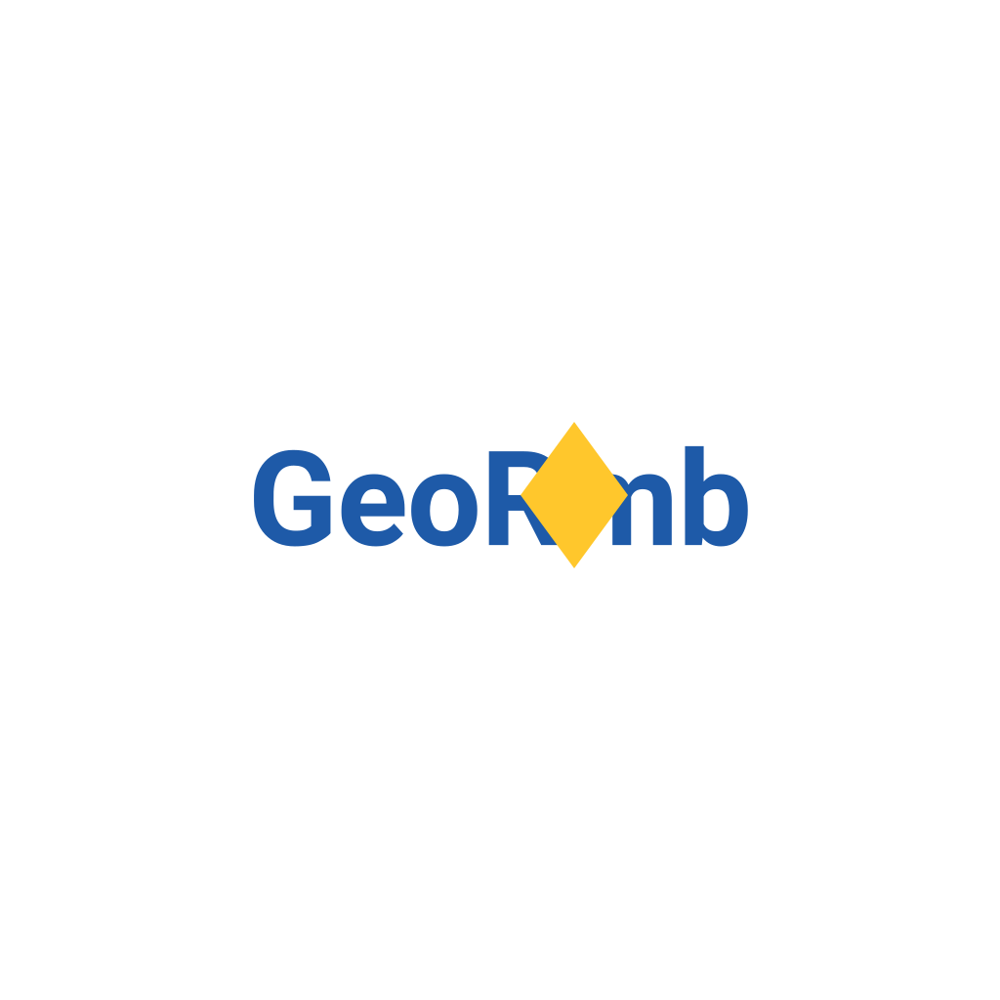
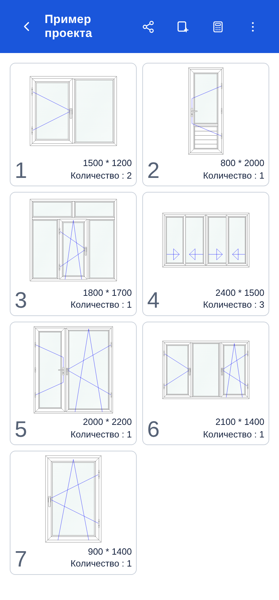
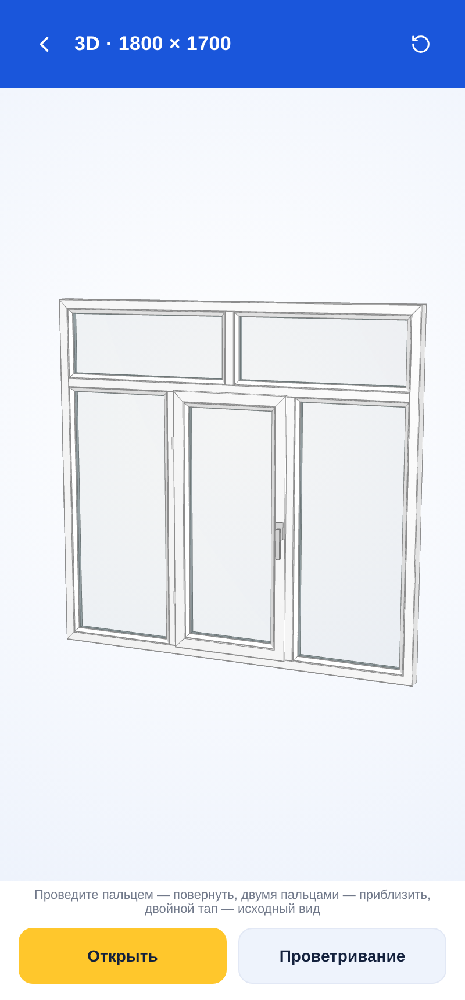
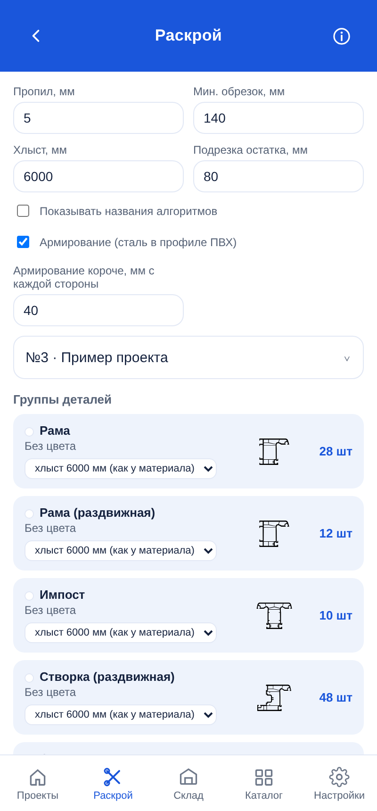
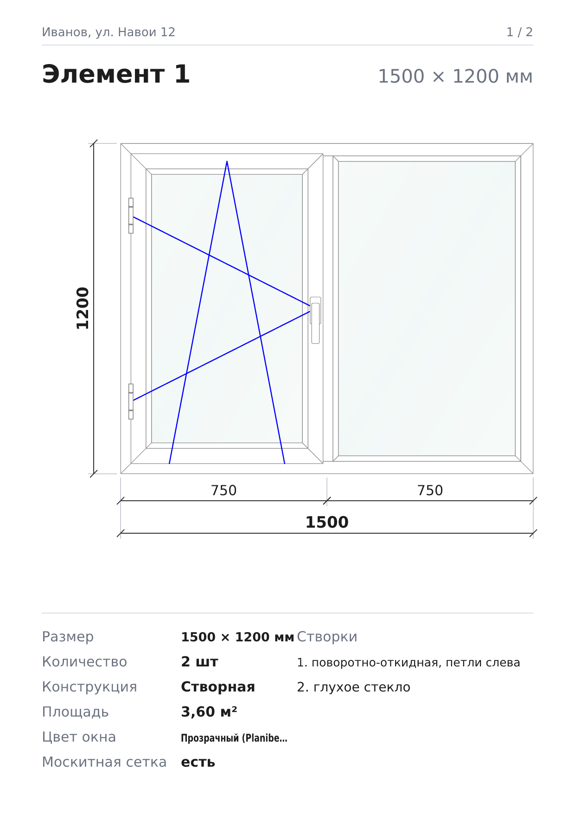

<p align="center">
  
</p>

<h1 align="center">GeoRomb</h1>

<p align="center">
  Расчёт окон и дверей из ПВХ и алюминия на телефоне: схема, смета, раскрой профиля и стекла, склад остатков, PDF для клиента.
</p>

<p align="center">
  
  
  
  
  
</p>

<p align="center">
  <a href="https://bakhtiyararzimetov.github.io/GeoRomb-app/">Скачать APK</a> ·
  <a href="docs/architecture.md">Архитектура</a> ·
  <a href="docs/api.md">API для бота</a> ·
  <a href="CHANGELOG.md">Изменения</a>
</p>

---

<p align="center">
  
  
  
  
</p>

## Возможности

- **Схема элемента**: окна, двери, раздвижные системы и подоконники. Импосты, створки (поворотные, поворотно-откидные, откидные, двери), панели, переплёты внутри створки, размерные линии, отмена и повтор.
- **3D-вид**: окно можно повернуть и открыть створку.
- **Смета**: профиль, фурнитура, стекло, панели, подоконники, армирование, москитные сетки, налог, учёт отходов профиля.
- **Раскрой профиля** по хлыстам: точный перебор с учётом пропила, минимального обрезка и остатков со склада. **Раскрой стекла** на листах.
- **Склад остатков**: раскрой сначала берёт подходящие остатки со склада, а годные обрезки после раскроя можно сохранить на склад.
- **Каталог** цветов профиля (RAL, ламинация, анодирование) и стёкол.
- **PDF** проекта, раскроя и списка стёкол на русском, узбекском и кыргызском, с ценами или без.
- **Резервная копия**: экспорт и импорт проектов файлом.
- **API для WhatsApp-бота**: JSON окна → готовый PDF ([docs/api.md](docs/api.md)).
- **Лицензии**: активация по ID устройства, коды подписаны ECDSA ([docs/licensing.md](docs/licensing.md)).

## Быстрый старт

Нужен Node.js 26+ ([.nvmrc](.nvmrc)).

```bash
npm install
npm run dev          # приложение в браузере: http://localhost:5173
npm test             # тесты
npm run server       # API для бота: http://localhost:3000/api/v1/generate-window-pdf
```

Сборка APK, выпуск версии и все команды — [docs/development.md](docs/development.md).

## Структура

```
georomb/
├── app/                 мобильное приложение (Vite + TypeScript, Capacitor)
│   ├── index.html       разметка экранов
│   └── src/
│       ├── types.ts     модель данных (Project, WinElement, TreeNode, Layout)
│       ├── data/        справочники: цвета, стёкла, профильные системы
│       ├── model/       расчёты без DOM: раскладка, смета, раскрой
│       ├── render/      SVG-схема и чертёж для PDF
│       ├── features/    экраны: проекты, элемент, 3D, раскрой, склад, цены, PDF, лицензия
│       ├── platform/    Capacitor и «Поделиться»
│       └── ui/          DOM-помощники и диалоги
├── server/              API для WhatsApp-бота: JSON проекта → PDF
│   ├── src/  test/  examples/
├── backend/src/         CLI лицензий: коды активации и revoked.json
├── shared/license.ts    формат кодов и подписи (общий для app и backend)
├── scripts/             служебные скрипты (копирование сборки в Capacitor)
├── docs/                документация
├── assets/              логотип и скриншоты
└── .github/             CI и шаблоны Issue / Pull Request
```

## Документация

| Документ | О чём |
|---|---|
| [docs/architecture.md](docs/architecture.md) | как устроены приложение, сервер и лицензии |
| [docs/development.md](docs/development.md) | команды, сборка APK, выпуск версии |
| [docs/api.md](docs/api.md) | API для WhatsApp-бота: запросы, формат проекта, ошибки |
| [docs/licensing.md](docs/licensing.md) | активация, выдача и отзыв кодов |
| [CONTRIBUTING.md](CONTRIBUTING.md) | правила работы с кодом |
| [SECURITY.md](SECURITY.md) | уязвимости и хранение ключей |
| [CHANGELOG.md](CHANGELOG.md) | история версий |

## Связь

Bakhtiyar Arzimetov — Telegram [@Bakhtiyar124](https://t.me/Bakhtiyar124) · WhatsApp [+7 747 945 39 26](https://wa.me/77479453926)

## Лицензия

© 2026 Bakhtiyar Arzimetov. Все права защищены. Копирование, изменение и распространение без письменного разрешения запрещены. Подробнее: [LICENSE](LICENSE).
